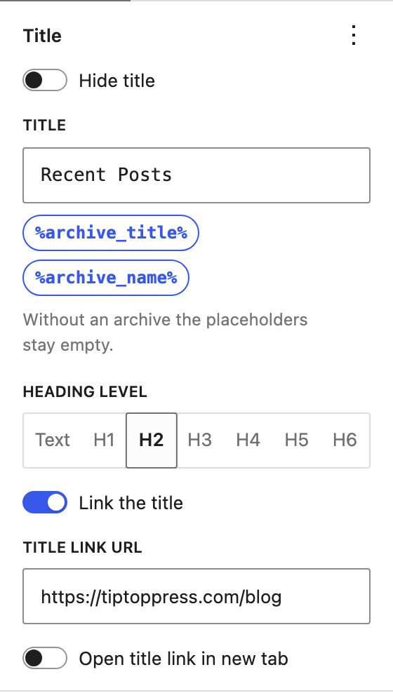
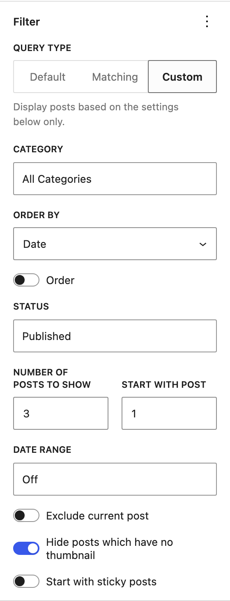
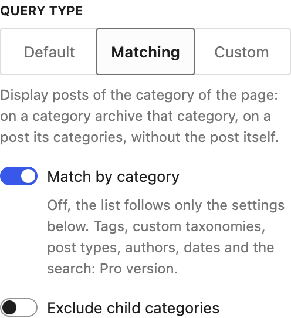
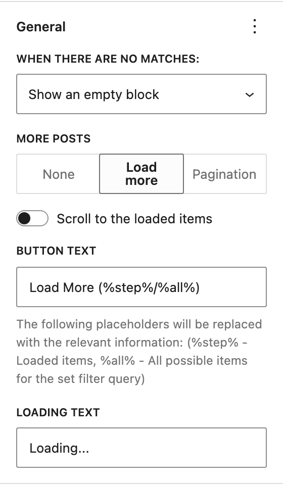
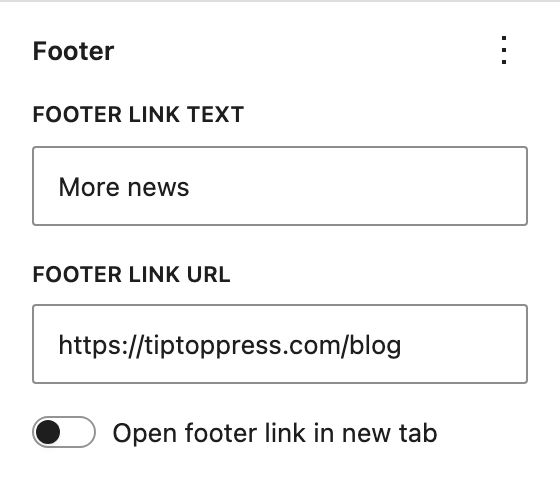
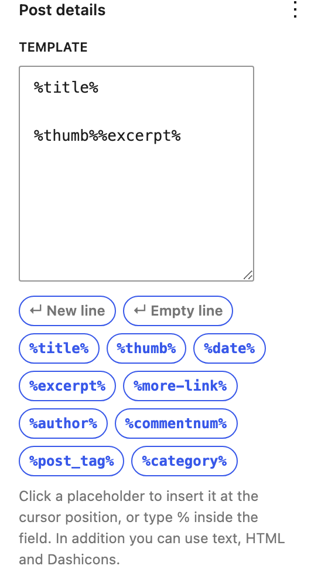
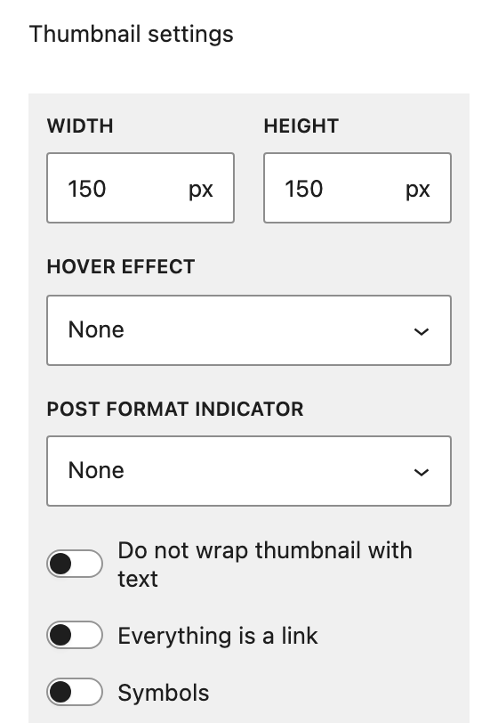
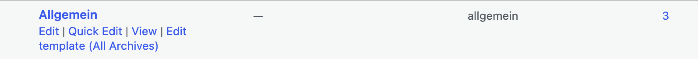

<!-- Arbeitsdokument / Vorschau der Seite
     https://tiptoppress.com/category-posts-widget/documentation/
     Änderungen hier machen, danach in documentation.html übertragen.
     Vorgehen und Werkzeuge: im Repo der Pro-Version unter docs/wordpress/ (HOWTO.md, tools/).
     Reihenfolge und Namen wie in der Seitenleiste des Blocks (src/edit.js). -->

# Documentation

Category Posts

## Getting started

Add the block **Category Posts** with the block inserter. You find it in the category *Widgets* or by searching for "category" or "recent posts".

For archive and other templates there is the variation **Category Posts of the Page**. It shows the posts of the page the block is on, with the layout of Category Posts. You find it in the category *Theme*, next to the Query Loop.

The settings are in the block sidebar:

- **Content tab:** Title, Filter, General and Footer
- **Settings tab:** Post details and Styles

WordPress versions without a Content tab show the first group in the Settings tab and the second one in the Styles tab.

Each panel shows the most used settings. More settings are in the **⋮ menu** of the panel. Choose a setting there to show it. "Reset all" in the same menu sets the panel back to its defaults.

## Title

The text above the list.

- **Hide title:** No title is shown.
- **Title:** The text of the title. It can contain placeholders, e.g. for a list in an archive template. Without an archive the placeholders stay empty.

| Placeholder | Description |
|---|---|
| %archive_title% | Title of the archive the list is on, e.g. "Category: News" |
| %archive_name% | The same without prefix, e.g. "News" |

- **Heading level:** Text, H1 to H6.
- **Link the title:** The title becomes a link.
  - **Title link URL:** The address of the link.
  - **Open title link in new tab**

**Note:** How to combine categories in one link you can read [here](https://benohead.com/wordpress-menu-items-combining-multiple-categories/).

## Filter

Here you control which posts are shown, how many and in which order.

### Query type

- **Default:** Shows exactly the posts of the page the list is on, e.g. the posts of a category archive. Use it in archive templates. A single view (post, page, 404) has no posts to take over: use "Matching" or "Custom" there, or place the list in an archive template.
- **Matching:** Shows posts of the category of the page: on a category archive that category, on a post its categories, without the post itself. **Match by category** switches this on; off, the list follows only the settings below. **Exclude child categories** leaves out the posts of the child categories.
- **Custom:** Shows posts based on the settings below only.

Tags, custom taxonomies, post types, authors, dates and the search of the page: [Pro version](https://tiptoppress.com/term-and-category-based-posts-widget/).

### Category

The category of the posts, or **All Categories**.

### Order

- **Order By:** Date, Title, Number of comments or Random.
- **Order:** reverses the order, e.g. the oldest posts first.

**Note:** "Random" is more resource demanding. With a page cache the order changes only when the cache is renewed, not with every page load.

### Status

WordPress Default, Published, Scheduled, Private, or a combination of them. With "Scheduled" posts are shown before their publish date.

### Number of posts / Start with post

- **Number of posts to show**
- **Start with post:** 1 starts with the first post, 2 with the second one, and so on. Useful for two lists, where the second one continues the first one.

### Date range

- **Days ago:** posts not older than the given number of days (**Up to**).
- **Between dates:** posts published **After** and **Before** the given dates.

### Exclude current post

On a single post the post itself is not shown in the list.

### Hide posts which have no thumbnail

Only posts with a featured image are shown.

### Start with sticky posts

Sticky posts are shown first.

## General

### No results

What happens if no post matches:

- **Show an empty block:** title and footer are shown.
- **Hide the block:** nothing is shown.
- **Show text:** the given text is shown. It can contain the placeholders of the title.

### More posts

- **None**
- **Load more:** a button below the list loads the next posts, as many as "Number of posts to show".
  - **Button text** and **Loading text**. The button text can contain placeholders:

| Placeholder | Description |
|---|---|
| %step% | Loaded items |
| %all% | All possible items for the set filter query |

  - **Scroll to the loaded items**
- **Pagination:** links to the next and previous pages of the list.

## Footer

- **Footer link text:** a link below the list, e.g. "More news".
- **Footer link URL:** the address of the link.
- **Open footer link in new tab**

## Post details

### Template

What each post shows, as placeholders. Click a placeholder to insert it at the cursor position, or type % inside the field. In addition you can use text, HTML and [Dashicons](https://developer.wordpress.org/resource/dashicons/).

| Placeholder | Description |
|---|---|
| New line | Line break |
| Empty line | Next line is a paragraph |
| %title% | Post title |
| %thumb% | Post thumbnail possibly wrapped by text |
| %date% | Post publish date |
| %excerpt% | Post excerpt |
| %more-link% | Read more text |
| %author% | Post author |
| %commentnum% | The number of comments to the post |
| %post_tag% | Post tags |
| %category% | Post categories |

Note: [How it works? and Examples.](https://tiptoppress.com/template-arrange-post-details/)

### Item title

- **Item title heading level:** Text, H1 to H6.
- **Item title lines:** the title is cut after this number of lines, with three dots. Empty means no limit.

### Excerpt

- **Excerpt lines:** the excerpt is cut after this number of lines. Empty means no limit.
- **Content:** the excerpt or the full post.

### More link

- **Read more text:** the text of the link to the post. Can be text, HTML and Dashicons.

### Date

- **Date format:** Site date and time, Site date, Reader's local date and time, Reader's local date or PHP style format.
- **PHP style date format:** any combination described on [this page](https://www.php.net/manual/en/function.date.php).
- **Relative date up to:** shows the age of a post, e.g. "3 days", instead of its date while it is not older than this.

### Thumbnail

- **Width** and **Height:** Auto keeps the image ratio.
- **Hover effect:** None, Darker, Brighter, Zoom in, Blur or Icon.
- **Post format indicator:** an icon for posts with a post format (video, gallery, …), at a corner or in the center. "HTML without styling" leaves the style to the theme.
- **Do not wrap thumbnail with text:** the text stays beside the image instead of flowing around it.
- **Everything is a link:** the whole post item links to the post.
- **Symbols:** for logos and icons instead of photos. The whole image is scaled to fit instead of filling the space.

## Styles

- **Disable the built-in CSS:** no CSS of the block. All styling is up to your own CSS.
- **Disable only font styles:** no font styles of the block.
- **Disable Theme's styles:** the classes WordPress adds for themes are left out, so the theme does not style the list.

## Transform into this block

A **Query Loop** can be turned into this block with "Transform" in the block toolbar, if the block can show the same posts.

A **classic widget** of this plugin in a widget area turns into the block the same way.

## Template links

In the list of categories, a link **Edit template (…)** opens the template with which the archive of the category is shown, directly in the site editor. If only a general template applies, e.g. "All Archives", **Create own template** copies it for this category.

The list of posts gets **Default single template** and **Archive template (Posts page)** next to "All | Published".

Which links are shown is set under *Settings → Category Posts*. Tags, custom taxonomies, pages and custom post types: [Pro version](https://tiptoppress.com/term-and-category-based-posts-widget/).

